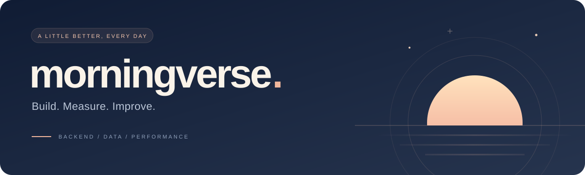

  

### I build backend services and prove them with numbers. | 백엔드 서비스를 만들고, 숫자로 증명합니다.

Fewer queries, faster responses, every choice backed by numbers I measured.  
쿼리는 줄이고 응답은 빠르게, 모든 선택은 직접 잰 숫자로 말합니다.

BUILD · MEASURE · IMPROVE

 

<table>
<tr>
<td width="400" valign="top">
<h3>01 / Build</h3>
<b>Build | 만들기</b>

Small, runnable code for real backend problems. 실제 백엔드 문제를 바로 돌아가는 작은 코드로.

</td>
<td width="400" valign="top">
<h3>02 / Measure</h3>
<b>Measure | 재기</b>

Query counts and response times, not guesses. 추측 대신 쿼리 수와 응답 시간으로.

</td>
<td width="400" valign="top">
<h3>03 / Improve</h3>
<b>Improve | 고치기</b>

Pick the fix and write down the trade-off. 고칠 방법을 고르고 트레이드오프까지 남기기.

</td>
</tr>
</table>

 

### Building now | 지금 만드는 것

**[backend-lab](https://github.com/morningverse67-wq/backend-lab)** &nbsp; 15 labs on queries, indexes, transactions and concurrency | 쿼리·인덱스·트랜잭션·동시성 실험 15개  
Python labs run with `python3 main.py`, standard library only · MyBatis lab: Java · MyBatis · MySQL · Docker

**[backend-interview-lab](https://github.com/morningverse67-wq/backend-interview-lab)** &nbsp; Backend interview answers backed by code I ran | 직접 돌려 본 코드로 답하는 백엔드 면접 정리  
N+1 501 → 1 query (321.82ms → 1.68ms) · selective index 887× · composite index order 505× · OFFSET vs cursor 244.7×

**[donworry-poc](https://github.com/morningverse67-wq/donworry-poc)** &nbsp; Insurance coverage checker PoC (team project) | 보험이 무엇을 몇 살까지 보장하는지 보여 주는 PoC (팀 과제)  
Single HTML · vanilla JS, no libraries, no server

### Building next | 다음에 만들 것

- Cache: LRU, stampede & single-flight, TTL + jitter | 캐시: LRU, 동시 만료 막기, single-flight
- API: rate limiter, retry with backoff, circuit breaker | API: 요청 제한, 백오프 재시도, 서킷 브레이커
- Server: connection pool sizing, timeouts on external calls | 서버: 커넥션 풀 크기, 외부 호출 타임아웃

### Writing | 글

**[Velog @morningverse](https://velog.io/@morningverse)** &nbsp; What I built, measured and fixed | 만들고, 재고, 고친 과정을 글로 씁니다

- [바닐라 JS 단일 HTML 앱 PoC 개발기: 이벤트 위임부터 Web Crypto 비밀번호 페이지의 한계까지](https://velog.io/@morningverse/바닐라-JS-단일-HTML-앱-PoC-개발기-이벤트-위임부터-Web-Crypto-비밀번호-페이지의-한계까지)
- [stale-if-error, 외부 API 장애 때 만료된 캐시를 돌려줘도 되는 경계 (Spring RestClient)](https://velog.io/@morningverse/stale-if-error-외부-API-장애-때-만료된-캐시를-돌려줘도-되는-경계-Spring-RestClient)
- [JWT 검증, Spring Boot 기본 설정이 놓치는 aud·iss·exp까지 테스트로 막기](https://velog.io/@morningverse/JWT-검증-Spring-Boot-기본-설정이-놓치는-audissexp까지-테스트로-막기)
- [Testcontainers 통합 테스트, 컨테이너 한 번만 띄우고 데이터 안 섞이게 (Spring Boot)](https://velog.io/@morningverse/Testcontainers-통합-테스트-컨테이너-한-번만)
- [Jira와 Linear, 무엇이 다를까?](https://velog.io/@morningverse/Jira와-Linear-무엇이-다를까)
- [MyBatis N+1 문제 해결, 로그 확인부터 일대다 페이징까지](https://velog.io/@morningverse/N1-%EC%BF%BC%EB%A6%AC%EB%8A%94-%EC%99%9C-%EC%83%9D%EA%B8%B8%EA%B9%8C)

### Tools | 도구

backend &nbsp; · &nbsp; `Java` &nbsp; `Spring Boot` &nbsp; `MyBatis` &nbsp; `MySQL` &nbsp; `SQL`  
experiments &nbsp; · &nbsp; `Python` &nbsp; `SQLite` &nbsp; `Docker`  
also &nbsp; · &nbsp; `JavaScript` &nbsp; `Swift`

 

---

  SMALL STEPS. MEASURED CHOICES. A LITTLE BETTER, EVERY DAY. | 작게, 재 보고, 매일 조금 더 낫게.

